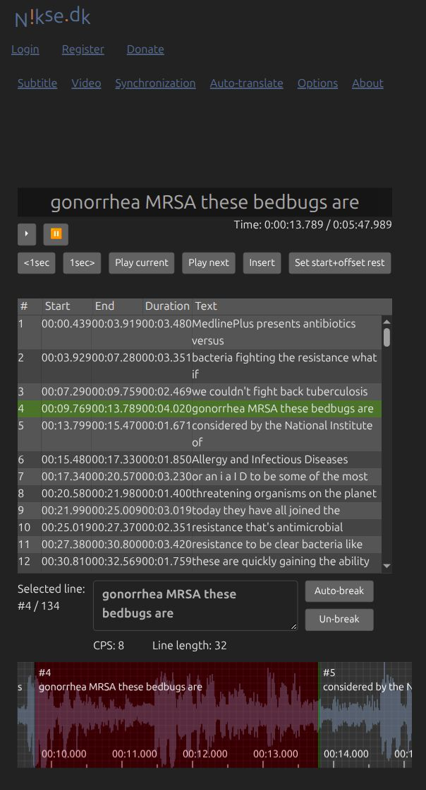

# Natural ASR and baseline walkthrough — 2026-10-19

**Decision:** the editing loop works on genuine automatic captions, but the present evidence does not justify a claim of reliable medical error detection or superiority to an existing editor. Keep the prototype small; defer feature expansion. No human participants or medical experts were available, so this is a developer-run capability check, not a user study.

## Public material and provenance

Source: MedlinePlus, National Library of Medicine.

- [Antibiotics video](https://medlineplus.gov/medlineplus-videos/antibiotics-vs-bacteria-fighting-the-resistance/) and its [official YouTube upload](https://www.youtube.com/watch?v=oLPAodRN1b0).
- [Naloxone video](https://medlineplus.gov/medlineplus-videos/how-naloxone-saves-lives-in-opioid-overdose/) and its [official YouTube upload](https://www.youtube.com/watch?v=cssRZEI9ujY).
- [NLM reuse policy](https://medlineplus.gov/about/using/usingcontent/) lists these MedlinePlus videos as public-domain material; keep source attribution. This does not imply endorsement. The older videos are transcription evidence, not current treatment guidance.

Actual YouTube **automatic captions** were downloaded with yt-dlp's `--write-auto-subs --skip-download --sub-langs en --sub-format vtt`; these were not generated or altered to insert errors by this project. Raw VTT files remain in `../public-audio/`. `natural-asr-differences.json` records video URLs and source hashes. No local model, extra transcription provider or paid service was used. The captions' original model/version and generation date are not exposed by this download.

`prepare.py` converts YouTube rolling captions into nonoverlapping SRT: keep the last nonempty payload line of substantive display cues and discard 10-ms repeated display frames. This retains single-word lines without inline timestamps, including “coming” and “preparation.” A draft converter initially lost those lines and leading payloads after whitespace-only lines; this was corrected before freezing the final analysis and live cases. The initial baseline import was replaced with the final 134-cue file. No wording is corrected in the final input.

## Offline results

| Sample | Natural ASR cues | Lexical difference groups vs publisher captions | Cues with any default rule signal |
|---|---:|---:|---:|
| Antibiotics | 134 | 25 | 14 |
| Naloxone | 123 | 17 | 1 |

All 257 cues round-trip with text and millisecond timestamps preserved. Lexical comparison uses lowercase words, normalized apostrophes and punctuation removal with Python SequenceMatcher. It does **not** expand written numbers, normalize contractions or judge clinical impact. Therefore the 42 difference groups are neither 42 confirmed errors nor WER. Examples such as “brainstem”/“brain stem” and digit/word number representations can be equivalent. Publisher captions are a reference, not independently verified acoustic ground truth.

Four deliberately selected discrepant ASR cues received **no default rule signals**. The default glossary has no aliases for these errors. Canonical-only domain terms also do not turn the alias matcher into a general error detector. `rule-results.json` records all signals. This result demonstrates a coverage limitation on these examples, not population recall.

## Four live Gemini checks on natural ASR

Cases were selected after inspecting source differences, then frozen before inference in `live-cases.json`. The glossary includes canonical Naloxone, Endorphins, MRSA, Staphylococcus aureus and NIAID in addition to the defaults; no observed misspelling was added as an alias. This is developer-selected and unblinded. The reference, neighboring cues and audio were withheld, matching the current one-cue product workflow.

All four API calls returned HTTP 200 (992, 1172, 908 and 1056 ms), at least 16 seconds apart through the running app's quota guard. No retries, model switching or automatic edits occurred. Raw quotes/reasons and model are in `gemini-natural-asr.json`. Token totals are unavailable through this adapter.

| Input discrepancy | Reference distinction | Model observation |
|---|---|---|
| `mersa`, plus `bedbugs` in the same cue | MRSA; “bad bugs” | Suggested MRSA for `mersa`; did not flag `bedbugs` |
| `patients death` | Publisher caption says “patients deaf” | Flagged **gonorrhea**, which matches the publisher caption; did not identify `death` |
| `orphans help produce the runner's high` | Endorphins; the preceding ASR cue ends with “and” | Suggested endorphins from glossary/context |
| `the lock zone is safe and unlikely to` | Naloxone | Flagged `lock zone` as a possible drug-name mishearing, without recovering a definite source word |

Do not report this as “75% accuracy.” Three cues received relevant leads, one received a misplaced warning, and even the first relevant cue contains an additional unflagged discrepancy. There are no independently scored negatives, confidence intervals or expert labels. The `patients death` example is evidence that a plausible-looking AI reply can direct attention away from the source mismatch. No clinical safety or corrected transcript quality is established.

## Existing-tool walkthrough

Baseline: [Subtitle Edit online](https://www.nikse.dk/subtitleedit/online), with the same final `antibiotics-asr.srt` and the same public MP3. The desktop application's [official overview](https://subtitleedit.github.io/subtitleedit/overview.html) is a separate reference; online findings must not be generalized to every desktop feature.

Verified through the browser UI: 134-cue import, matching MP3 duration, a visible waveform, selection and playback of cue 4, stopping at its end, and editing `mersa` to `MRSA` while preserving that cue's displayed times (9.769–13.789 s). The export dialog offers SubRip and UTF-8. Clicking Download closed the dialog, but the automation did not capture a download event; **the resulting baseline file and its full integrity remain unverified**. This is not evidence that export is broken. No accounts, translation provider or paid option were used. Only these public sample files were attached.



| Capability checked | MedCue | Subtitle Edit online |
|---|---|---|
| Same natural ASR file and matching audio | Passed | Passed for antibiotics |
| Waveform and selected-cue playback | Passed | Observed working |
| Text editing | Edit/undo regression passed | MRSA edit observed |
| Export integrity | All 257 cues preserved | Download capture unavailable; not scored |
| Suggested error locations | Default rules miss four selected discrepant cues; AI has relevant and misplaced leads | Automated error detection not tested |
| Human task time or preference | Not measured | Not measured |

MedCue's two direct file controls avoid two menu dialogs in this online baseline, while both still require selecting files and inspecting the recording. This is a visible workflow difference, **not measured time savings**. No optimized keyboard comparison or baseline glossary workflow was tested. We have not established a competitive advantage.

## MedCue browser checks and boundaries

`browser-results.json` records two isolated Chrome contexts against the production app: 257-cue import/export, actual speech decoding, seeking to the natural-error cues, 0.75×/1.25× playback, automatic stop, edit/undo and marking reviewed. No browser errors or POST requests occurred in this media test. The owner's draft was untouched. Screenshots are `antibiotics-browser.png` and `naloxone-browser.png`.

No human study has taken place. Someone without medical training can test finding controls and whether text matches a clear recording, using the official captions for later adjudication. That cannot establish medical truth, resolve ambiguous speech professionally or measure expert editing performance. Do not replace missing participants with agent timings or simulated personas. Existing requirements for broader speakers, independent reviewers and repeated use remain unmet.

## Practical next decision

The narrow **source-fidelity review** job is plausible; a general standalone subtitle editor is already well served. The current alias rules and one-cue AI are insufficient grounds for a larger medical-correction product. Prefer a small evidence-oriented companion workflow, and investigate neighboring-cue context only as a bounded experiment before adding it to the product. Do not seed observed errors into the glossary and call a rerun independent validation. Retention, demand and willingness to switch remain unknown.

Existing-solution preflight also found [Omi Health's public medical STT benchmark](https://github.com/Omi-Health/medical-STT-eval), which publishes reference/model transcripts based on PriMock57. Its public tree was recorded in a local-only `upstream-tree.json` (excluded from publication); no benchmark score, transcript or audio from it was used here. Simulated consultation dialogue differs from the chosen educational-video audience, so it was not silently substituted for the actual NLM task.

## Reproduce without additional inference

From the project root:

```sh
python3 evaluation/editor-study/prepare.py
node evaluation/editor-study/rules.mjs
# Requires running production app at port 8080 and Chrome:
node evaluation/public-audio/browser.mjs --natural-asr
```

To acquire the raw VTTs again, use the yt-dlp command above with the two official YouTube URLs; preserve existing raw evidence and hashes. `live.mjs` refuses to repeat a recorded live run. `natural-asr-samples.zip` includes the actual automatic SRTs, matching MP3s, raw VTTs, attribution/report and clearly separated publisher references. It contains no fabricated participant results. The material is not automatically published by the app.
